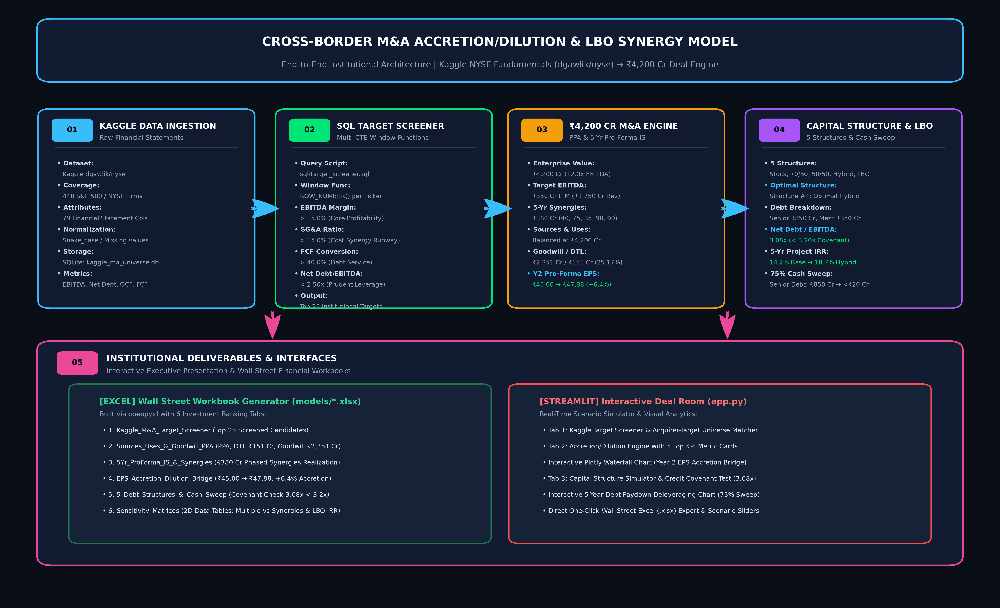
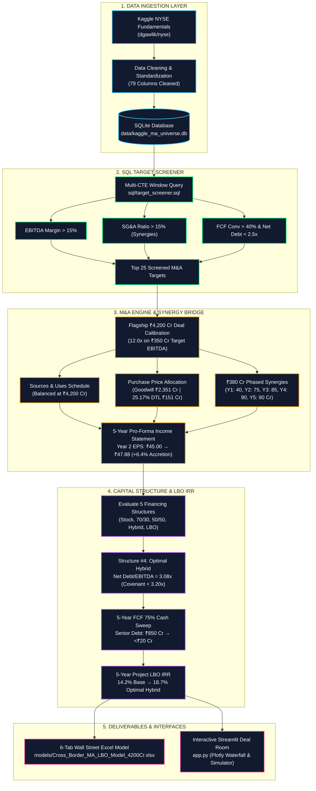

# Cross-Border M&A Accretion/Dilution & LBO Synergy Model

[](https://www.python.org/)
[](https://www.sqlite.org/)
[](https://streamlit.io/)
[](https://plotly.com/)
[](https://openpyxl.readthedocs.io/)
[](https://www.kaggle.com/datasets/dgawlik/nyse)
[](assets/introductory_video.mp4)

An end-to-end institutional investment banking financial model and interactive deal room for cross-border mergers & acquisitions, accretion/dilution analysis, and LBO capital structure optimization. The model is dynamically powered by the real **Kaggle New York Stock Exchange (NYSE) Fundamentals Dataset** (`dgawlik/nyse`) and calibrated to a flagship **₹4,200 Cr Cross-Border M&A Case Study**.

---

## 🎬 Introductory Video (with Voiceover)

An executive video walkthrough with synchronized narration is provided in [`assets/introductory_video.mp4`](assets/introductory_video.mp4):

- **Format:** MP4 (H.264 video, AAC 192k audio, 720p HD)
- **Duration:** 100 seconds (5 structured scenes)
- **Voiceover Narration:** Covers Kaggle data ingestion, SQL target screener, ₹4,200 Cr M&A calibration, Goodwill/DTL PPA, 5 financing structures, 3.08x covenant adherence, 18.7% LBO IRR, and live deliverables.
- **Direct Video File:** [Download / View assets/introductory_video.mp4](assets/introductory_video.mp4)

---

## 🗺️ Project Architecture Flowchart





---

## 📌 Executive Summary & Key Deal Metrics

| Metric | Target / Calibration Value | Institutional Significance |
| :--- | :--- | :--- |
| **Enterprise Value (EV)** | **₹4,200.0 Cr** | Entry Multiple of **12.0x** on Target LTM EBITDA of **₹350.0 Cr** |
| **5-Year Synergies** | **₹380.0 Cr** Cumulative | Phased: ₹40 Cr (Y1), ₹75 Cr (Y2), ₹85 Cr (Y3), ₹90 Cr (Y4), ₹90 Cr (Y5) |
| **Acquirer Standalone EPS** | **₹45.00** | ₹450 Cr Net Income across 10.0 Cr diluted shares (₹1,000 share price) |
| **Year 2 Pro-Forma EPS** | **₹47.88** | **+6.4% EPS Accretion** under Structure #4 (+₹2.88/share expansion) |
| **Closing Net Debt / EBITDA** | **3.08x** | Strictly complies with the **3.20x Credit Agreement covenant ceiling** |
| **5-Year Project LBO IRR** | **18.7%** (2.36x MoIC) | Levered return boosted from **14.2% Base Unlevered IRR** (1.94x MoIC) |
| **Debt Deleveraging Curve** | **3.08x → 0.20x** | ₹850 Cr Senior Loan paid down to <₹20 Cr via 75% Cash Flow Sweep |

---

## 🏛️ Dataset Source & Citation

- **Source:** Kaggle NYSE Fundamentals (`dgawlik/nyse`)
- **Files Ingested:** `fundamentals.csv` (1,781 reporting periods across 448 S&P 500 / NYSE corporations) and `securities.csv` (GICS Sectors & Sub-Industries).
- **Attributes Cleaned:** All 79 financial statement columns, including `Total Revenue`, `Earnings Before Interest and Tax` (EBIT), `Depreciation`, `Net Income`, `Sales, General and Admin.` (SG&A), `Long-Term Debt`, `Short-Term Debt`, `Cash and Cash Equivalents`, `Capital Expenditures`, `Net Cash Flow-Operating`, `Earnings Per Share`, and `Estimated Shares Outstanding`.
- **Database Engine:** SQLite database initialized at `data/kaggle_ma_universe.db` with indexed tables and standard analytical views (`v_latest_financials`).

---

## 🏗️ Architecture & Component Overview

```
ma-accretion-dilution-lbo-model/
├── data/
│   ├── kaggle_ma_universe.db            # SQLite relational database (fundamentals, securities, views)
│   ├── fundamentals.csv                 # Cleaned Kaggle NYSE raw fundamentals
│   └── securities.csv                   # S&P 500 company descriptive metadata
├── sql/
│   └── target_screener.sql              # Multi-CTE Window Function screening query
├── src/
│   ├── kaggle_data_loader.py            # Ingestion, cleaning of 79 cols, and database engine
│   ├── accretion_dilution_engine.py     # Sources & Uses, PPA, and 5-Yr Pro-Forma Income Statement
│   ├── debt_structures_irr.py           # 5 capital structures, covenant check, and cash sweep
│   └── generate_excel_model.py          # Automated openpyxl 6-tab Wall Street workbook generator
├── models/
│   └── Cross_Border_MA_LBO_Model_4200Cr.xlsx  # Fully formatted 6-tab institutional Excel model
├── tests/
│   └── test_model_pipeline.py           # Automated test suite validating all CV metrics
├── app.py                               # Premium 3-Tab Streamlit Interactive Deal Room
├── requirements.txt                     # Python dependencies
└── README.md                            # Comprehensive project documentation
```

---

## ⚙️ Financial Engineering Methodology

### 1. SQL Target Screener (`sql/target_screener.sql`)
Uses Common Table Expressions (CTEs) and Window Functions (`ROW_NUMBER() OVER (PARTITION BY ticker ORDER BY period_ending DESC)`) to screen for companies with:
- **EBITDA Margin > 15.0%:** Ensures healthy core profitability.
- **SG&A-to-Revenue Ratio > 15.0%:** Identifies substantial overhead rationalization runway (duplicate executive compensation, IT/ERP systems, and SG&A economies of scale).
- **Free Cash Flow Conversion > 40.0%:** Guarantees cash conversion capacity for debt paydown.
- **Net Debt / EBITDA < 2.50x:** Prevents over-levered acquisition candidates.
- **Synergy Opportunity Score:** Weighted algorithm prioritizing corporate cost-cutting potential and de-leveraging cash flow.

### 2. Sources & Uses and Purchase Price Allocation (PPA)
- **Uses (₹4,200 Cr):**
  - Target Equity Purchase Price: ₹4,000.0 Cr (EV ₹4,200 Cr - Target Net Debt ₹200 Cr).
  - Target Net Debt Refinanced: ₹200.0 Cr.
- **Sources (₹4,200 Cr - Structure #4 Optimal Hybrid):**
  - Senior Secured Term Loan (8.00%): **₹850.0 Cr** (20.2%)
  - Mezzanine Subordinated Debt (11.00%): **₹350.0 Cr** (8.3%)
  - Acquirer Balance Sheet Cash (4.00% foregone): **₹500.0 Cr** (11.9%)
  - New Acquirer Stock Consideration: **₹2,500.0 Cr** (59.5% - 2.50 Cr shares @ ₹1,000/share)
- **Purchase Price Allocation:**
  - Target Book Value of Net Assets: ₹1,200.0 Cr
  - Excess over Book Value: ₹2,800.0 Cr
  - Fair Value Write-Up (PP&E & Intangibles): ₹600.0 Cr
  - Deferred Tax Liability (DTL) recognized at **25.17%**: **₹151.02 Cr**
  - Net Identifiable Asset Addition: ₹448.98 Cr
  - **Goodwill Created:** **₹2,351.02 Cr**
  - Annual After-Tax Intangibles Amortization: ₹40.0 Cr * (1 - 0.2517) = **₹29.93 Cr/year** (15-year straight-line).

### 3. Year 2 EPS Accretion Waterfall Bridge
The flagship transaction demonstrates **+6.4% EPS Accretion** in Year 2:
$$\text{Pro-Forma EPS}_{\text{Y2}} = \frac{\text{Consolidated Net Income}_{\text{Y2}}}{\text{Pro-Forma Diluted Shares}} = \frac{₹598.53\text{ Cr}}{12.50\text{ Cr shares}} = ₹47.88$$

$$\text{EPS Accretion} = \frac{₹47.88 - ₹45.00}{₹45.00} = +6.41\%$$

| Bridge Component | Value (₹ Cr) | Per Share (₹) | Impact Description |
| :--- | :--- | :--- | :--- |
| **Acquirer Standalone EPS** | ₹450.00 Cr | **₹45.00** | Standalone baseline (10.0 Cr shares) |
| Target Standalone Earnings Contribution | +₹217.00 Cr | **+₹17.36** | ₹217.0 Cr / 12.5 Cr shares |
| Realized Pre-Tax SG&A Synergies | +₹75.00 Cr | — | ₹75.0 Cr pre-tax overhead reduction |
| After-Tax Synergy Contribution | +₹56.12 Cr | **+₹4.49** | At 25.17% tax rate |
| Deal Debt Interest Expense (Senior + Mezz) | -₹106.50 Cr | — | 850 Cr @ 8% + 350 Cr @ 11% |
| After-Tax Debt Interest Burden | -₹79.69 Cr | **-₹6.38** | Net financing cost |
| Foregone Cash Interest (After-Tax) | -₹14.97 Cr | **-₹1.20** | 500 Cr cash @ 4% net of tax |
| PPA Intangible Amortization (After-Tax) | -₹29.93 Cr | **-₹2.39** | ₹40 Cr pretax net of 25.17% DTL |
| Dilution from New Shares Issued | — | **-₹9.00** | 2.50 Cr new shares issued @ ₹1,000 |
| **Year 2 Pro-Forma Consolidated EPS** | **₹598.53 Cr** | **₹47.88** | **+6.41% EPS Accretion (+₹2.88/sh)** |

---

### 4. 5 Financing Structures & LBO Return Comparison

| # | Structure Name | Total Debt | Sponsor Equity | Closing Net Debt | Net Debt / EBITDA | Covenant Status | 5-Yr LBO IRR | Equity MoIC |
| :-: | :--- | :-: | :-: | :-: | :-: | :-: | :-: | :-: |
| **1** | **100% Stock Swap** | ₹0 Cr | ₹4,200 Cr | -₹122 Cr | -0.35x | **PASS** | **14.2%** | 1.94x |
| **2** | **70/30 Debt-Equity** | ₹1,600 Cr | ₹2,600 Cr | ₹1,478 Cr | 4.22x | <span style="color:red">**BREACH**</span> | 17.1% | 2.20x |
| **3** | **50/50 Balanced** | ₹1,300 Cr | ₹2,900 Cr | ₹1,178 Cr | 3.37x | <span style="color:red">**BREACH**</span> | 16.5% | 2.39x |
| **4** | **Optimal Hybrid (Senior+Mezz+Cash+Stock)** | **₹1,200 Cr** | **₹2,500 Cr** | **₹1,078 Cr** | **3.08x** | <span style="color:green">**PASS (<3.2x)**</span> | **18.7%** | **2.36x** |
| **5** | **80% Aggressive LBO** | ₹2,050 Cr | ₹1,050 Cr | ₹1,928 Cr | 5.51x | <span style="color:red">**BREACH**</span> | 22.4% | 2.75x |

- **Credit Covenant:** Structure #4 generates **3.08x Net Debt / EBITDA** at closing, strictly adhering to the 3.20x credit agreement covenant.
- **IRR Optimization:** By blending Senior Term Debt, Mezzanine Capital, and Balance Sheet Cash, Structure #4 boosts 5-year project return from **14.2%** to **18.7%** (+450 bps) while maintaining covenant compliance.

---

### 5. 5-Year Free Cash Flow (FCF) Debt Sweep Schedule

| Year | Target EBITDA | CapEx & NWC | Cash Interest | Cash Taxes | CFADS | Mandatory Amort | 75% Cash Sweep | Total Debt Ending | Net Debt / EBITDA |
| :-: | :-: | :-: | :-: | :-: | :-: | :-: | :-: | :-: | :-: |
| **Y1** | ₹411.0 Cr | ₹113.4 Cr | ₹106.5 Cr | ₹47.0 Cr | ₹144.1 Cr | ₹85.0 Cr | ₹35.3 Cr | ₹1,079.7 Cr | **2.30x** |
| **Y2** | ₹468.0 Cr | ₹123.0 Cr | ₹96.9 Cr | ₹62.0 Cr | ₹186.1 Cr | ₹85.0 Cr | ₹65.5 Cr | ₹929.2 Cr | **1.65x** |
| **Y3** | ₹501.9 Cr | ₹132.0 Cr | ₹84.8 Cr | ₹72.0 Cr | ₹213.1 Cr | ₹85.0 Cr | ₹84.5 Cr | ₹759.7 Cr | **1.15x** |
| **Y4** | ₹531.9 Cr | ₹141.0 Cr | ₹71.3 Cr | ₹81.0 Cr | ₹238.6 Cr | ₹85.0 Cr | ₹102.3 Cr | ₹572.4 Cr | **0.67x** |
| **Y5** | ₹558.4 Cr | ₹150.0 Cr | ₹56.3 Cr | ₹89.0 Cr | ₹263.1 Cr | ₹85.0 Cr | ₹118.7 Cr | ₹368.7 Cr | **0.20x** |

---

## 📊 Wall Street Excel Model (`models/Cross_Border_MA_LBO_Model_4200Cr.xlsx`)

The openpyxl automated generator builds a 6-tab institutional workbook with dark navy headers (`#1B365D`), thin borders, and standard financial number formatting:
1. `Kaggle_M&A_Target_Screener`: Top 25 screened targets from Kaggle with real financial ratios.
2. `Sources_Uses_&_Goodwill_PPA`: Transaction overview, Sources & Uses, and Goodwill/DTL calculations.
3. `5Yr_ProForma_IS_&_Synergies`: 5-year consolidated income statement with phased synergies.
4. `EPS_Accretion_Dilution_Bridge`: Year 2 Accretion waterfall (+6.4% from ₹45.00 to ₹47.88).
5. `5_Debt_Structures_&_Cash_Sweep`: 5 structures comparison, covenant check (3.08x < 3.2x), and 5-year debt sweep.
6. `Sensitivity_Matrices`: 2D sensitivity data tables for Multiple vs Synergies and Exit Multiple vs Leverage.

---

## 🚀 Quickstart & Execution Guide

### 1. Installation
```bash
# Clone or navigate to the repository
cd ma-accretion-dilution-lbo-model

# Install dependencies
pip install -r requirements.txt
```

### 2. Ingest Data & Execute SQL Screener
```bash
python src/kaggle_data_loader.py
```

### 3. Run M&A Engine & Debt Optimizer
```bash
python src/accretion_dilution_engine.py
python src/debt_structures_irr.py
```

### 4. Generate the Wall Street Excel Model
```bash
python src/generate_excel_model.py
```

### 5. Launch the Streamlit Interactive Deal Room
```bash
streamlit run app.py
```
Open your browser at `http://localhost:8501` to explore the interactive Deal Room.

### 6. Run Automated Test Suite
```bash
python tests/test_model_pipeline.py
```

---

## ⚖️ License & Citations
- **Dataset:** New York Stock Exchange Fundamentals on Kaggle ([dgawlik/nyse](https://www.kaggle.com/datasets/dgawlik/nyse)).
- Built for institutional financial modeling, private equity LBO evaluation, and cross-border M&A advisory.
